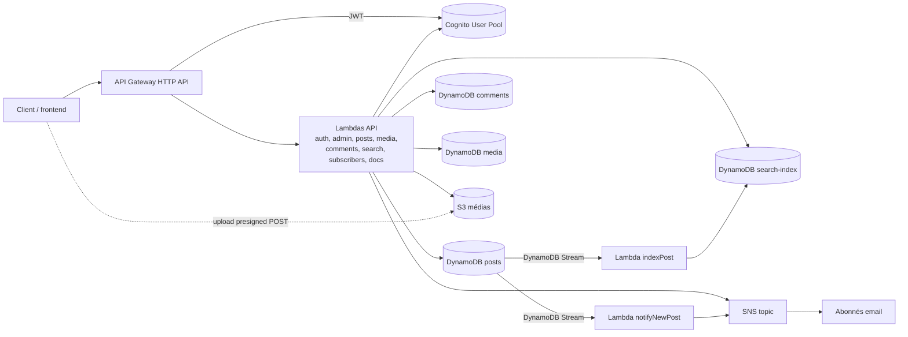

# Blogify

Backend de blog headless, sans serveur : Serverless Framework v4, AWS Lambda (Node.js 22, JavaScript ESM), API Gateway HTTP API, DynamoDB, S3, Cognito, SNS. Le projet ne contient aucun frontend : l'API REST est documentée en OpenAPI et servie avec Swagger UI.

Le plan de réalisation et les décisions de conception sont dans [PLAN.md](PLAN.md).

## Fonctionnalités

- Authentification Cognito (inscription, confirmation par email, connexion, rafraîchissement du token) et trois rôles : `admin`, `editor`, `guest_author`.
- Articles : CRUD, cycle de vie `draft`, `pending_review`, `published`, `archived`, slug généré, pagination, filtres par tag et par auteur.
- Médias : upload direct vers S3 par presigned POST (types et tailles contrôlés), lecture par URL présignée.
- Commentaires publics avec modération (`pending`, `approved`, `rejected`).
- Recherche plein texte par index inversé, alimenté par le DynamoDB Stream des articles.
- Notifications par email (SNS) à chaque nouvelle publication, avec abonnement public.
- Documentation OpenAPI 3 (`GET /docs`, `GET /openapi.json`).
- Stages `dev` et `prod` (région `eu-north-1`) plus des stages personnels pour tester, tests unitaires, smoke test de bout en bout, CI/CD GitHub Actions.

## Architecture



Choix principaux :

- Les rôles sont les groupes Cognito. Ils sont lus dans le claim `cognito:groups` de l'ID token et vérifiés dans le middleware `api()` ([src/lib/handler.js](src/lib/handler.js)). Il n'y a pas de table utilisateurs : nom et identifiant de l'auteur viennent des claims et sont dénormalisés dans l'article.
- Quatre tables DynamoDB en paiement à la requête : `posts`, `comments`, `media`, `search-index`.
- Le bucket S3 est privé (chiffrement, accès public bloqué). Les fichiers sont envoyés et lus uniquement via des URL présignées.
- La recherche et les notifications sont asynchrones : elles sont déclenchées par le Stream de la table `posts`.

## Rôles et permissions

| Action                                                              | Anonyme | `guest_author`         | `editor` | `admin` |
| ------------------------------------------------------------------- | ------- | ---------------------- | -------- | ------- |
| Lire les articles publiés, rechercher, lire les médias              | oui     | oui                    | oui      | oui     |
| Lister et poster des commentaires (en `pending`), s'abonner         | oui     | oui                    | oui      | oui     |
| Créer un article (`draft` ou `pending_review`)                      | non     | oui                    | oui      | oui     |
| Modifier ou supprimer un article                                    | non     | les siens, non publiés | tous     | tous    |
| Soumettre à relecture (`draft` vers `pending_review`)               | non     | ses articles           | oui      | oui     |
| Publier, archiver, dépublier                                        | non     | non                    | oui      | oui     |
| Voir les brouillons des autres, file de relecture (`/posts/review`) | non     | non                    | oui      | oui     |
| Envoyer, lister et supprimer ses médias                             | non     | oui                    | oui      | oui     |
| Lister ou supprimer les médias des autres                           | non     | non                    | oui      | oui     |
| Modérer et supprimer des commentaires                               | non     | non                    | oui      | oui     |
| Lister les utilisateurs, changer le rôle d'un utilisateur           | non     | non                    | non      | oui     |

Tout nouveau compte est ajouté au groupe `guest_author`. Un utilisateur sans groupe est traité comme `guest_author`.

## Prérequis

| Outil                       | Version                   | Vérification                  |
| --------------------------- | ------------------------- | ----------------------------- |
| Git                         | récente                   | `git --version`               |
| Node.js et npm              | Node 22.9 ou plus         | `node --version`              |
| AWS CLI v2                  | v2                        | `aws --version`               |
| Compte AWS avec des droits  | voir ci-dessous           | `aws sts get-caller-identity` |
| Compte Serverless Framework | gratuit (voir ci-dessous) | `npx serverless login`        |

- **AWS CLI** : installation décrite sur <https://docs.aws.amazon.com/cli/latest/userguide/getting-started-install.html>. Elle sert à configurer les credentials et à quelques commandes d'administration (confirmer un compte, ajouter un administrateur, vider le bucket).
- **Compte AWS** : celui du groupe ou un compte personnel. Pour un compte de test, la politique `AdministratorAccess` est la plus simple. Sinon, il faut pouvoir gérer CloudFormation, IAM (création de rôles), Lambda, API Gateway, DynamoDB, S3, Cognito, SNS et CloudWatch Logs. Tout le projet vit dans la région `eu-north-1`.
- **Compte Serverless Framework** : Serverless v4 refuse de fonctionner sans authentification. La création du compte est gratuite et se fait pendant `npx serverless login` ; l'usage est gratuit selon les conditions de licence de Serverless (voir <https://www.serverless.com/pricing>).
- Les commandes de ce document fonctionnent dans Git Bash, WSL, macOS et Linux (bash). Les différences pour PowerShell (Windows) sont indiquées à chaque fois.

## Installation

```bash
git clone https://github.com/adnar19/5LAMB-Blogging-Platform-.git blogify
cd blogify
npm ci
```

`npm ci` installe exactement les versions du `package-lock.json`, y compris le CLI Serverless (utilisé par `npx serverless`). Le fichier `.gitattributes` force les fins de ligne LF, y compris sous Windows.

Vérifier que l'installation est saine, sans AWS ni Serverless :

```bash
npm test
npm run lint
npm run format:check
npm run openapi:lint
```

Les tests unitaires simulent les services AWS. L'API complète ne peut pas tourner entièrement sur le poste (Cognito, DynamoDB, S3 et SNS ne sont pas émulés) : pour l'essayer, il faut déployer un stage personnel sur AWS (voir ci-dessous).

## Configuration AWS et Serverless

À faire une fois par poste.

**1. Credentials AWS.** Au choix :

```bash
# Identity Center (SSO) : suivre les questions, puis ouvrir la session
aws configure sso --profile blogify
aws sso login --profile blogify

# ou clés d'accès IAM
aws configure --profile blogify

# ou connexion avec un compte console existant (AWS CLI 2.32 ou plus) : ouvre le navigateur
aws login --region eu-north-1 --profile blogify
```

Utiliser `eu-north-1` comme région par défaut. Le compte AWS de l'école n'autorise que cette région (une Service Control Policy de l'organisation refuse toutes les autres) : un déploiement dans une autre région échoue avec `explicit deny in a service control policy`. Activer le profil dans le terminal courant (à refaire dans chaque nouveau terminal) :

```bash
export AWS_PROFILE=blogify          # bash
```

```powershell
$env:AWS_PROFILE = "blogify"        # PowerShell
```

Vérifier que le compte et l'identité affichés sont les bons :

```bash
aws sts get-caller-identity
```

Si la variable d'environnement `AWS_REGION` est définie sur le poste, elle doit valoir `eu-north-1`.

**2. Serverless Framework.**

```bash
npx serverless login
```

Le navigateur s'ouvre pour se connecter ou créer le compte. Le `serverless.yml` du projet ne définit ni `org` ni `app` : si le CLI propose d'en créer ou d'en choisir une au premier déploiement, il est possible de continuer sans.

## Déploiement

### Déployer son stage personnel

Chaque stage correspond à un stack CloudFormation indépendant `blogify-<stage>` (tables, User Pool, bucket, topic SNS, Lambdas, API). Chaque personne déploie son propre stage :

- Nom de stage : minuscules, chiffres et tirets, 15 caractères maximum, par exemple `dev-alice`.
- Ne jamais partager un nom de stage dans le même compte AWS : un déploiement écraserait le stage de l'autre personne.
- `dev` et `prod` sont réservés à la CI (branches `develop` et `main`) : ne pas les déployer à la main.

```bash
npm run deploy -- --stage dev-alice
```

La commande affiche à la fin les URL des endpoints. Pour redéployer après une modification du code, relancer la même commande. Les logs d'une fonction se consultent avec :

```bash
npx serverless logs --function listPosts --stage dev-alice --tail
```

Tout stage autre que `dev` et `prod` reprend les paramètres par défaut, identiques à ceux de `dev` (voir plus bas).

### Récupérer l'URL de l'API et les identifiants

Le stack expose les sorties `HttpApiUrl`, `UserPoolId`, `UserPoolClientId`, `MediaBucketName` et `NewPostTopicArn`. Pour les afficher :

```bash
npm run info -- --stage dev-alice
aws cloudformation describe-stacks --stack-name blogify-dev-alice --region eu-north-1 --query "Stacks[0].Outputs" --output table
```

Pour enregistrer les trois valeurs utilisées dans la suite du document :

```bash
# bash
STACK=blogify-dev-alice
out() { aws cloudformation describe-stacks --stack-name "$STACK" --region eu-north-1 --query "Stacks[0].Outputs[?OutputKey=='$1'].OutputValue" --output text; }
API_URL=$(out HttpApiUrl)
USER_POOL_ID=$(out UserPoolId)
BUCKET=$(out MediaBucketName)
```

```powershell
# PowerShell
$STACK = "blogify-dev-alice"
function Get-Output($key) { aws cloudformation describe-stacks --stack-name $STACK --region eu-north-1 --query "Stacks[0].Outputs[?OutputKey=='$key'].OutputValue" --output text }
$API_URL = Get-Output HttpApiUrl
$USER_POOL_ID = Get-Output UserPoolId
$BUCKET = Get-Output MediaBucketName
```

Vérification rapide : `GET $API_URL/posts` doit répondre `200` avec une liste vide, et `$API_URL/docs` affiche Swagger UI.

### Valider le déploiement avec le smoke test

Le smoke test joue un scénario complet sur le stage (voir « Tests et qualité ») : c'est le moyen le plus rapide de vérifier que tout fonctionne.

```bash
cp .env.example .env                 # PowerShell : Copy-Item .env.example .env
# éditer .env : SMOKE_EMAIL=<votre vraie adresse email>
npm run smoke -- --stage dev-alice
```

### Configuration par stage

Les paramètres sont dans la section `params` de [serverless.yml](serverless.yml).

| Paramètre                                         | `dev` et stages personnels | `prod`                                                 |
| ------------------------------------------------- | -------------------------- | ------------------------------------------------------ |
| Rétention des logs                                | 14 jours                   | 90 jours                                               |
| Origines CORS (`corsOrigins`)                     | `*`                        | `https://blogify.example.com` (à adapter)              |
| `siteUrl` (liens dans les emails de notification) | `http://localhost:3000`    | `https://blogify.example.com` (à adapter)              |
| Tables, User Pool (`deletionPolicy`)              | supprimés avec le stack    | conservés (`Retain`), protection contre la suppression |
| Point-in-time recovery DynamoDB                   | non                        | oui                                                    |
| Throttling global (req/s, rafale)                 | 50 / 100                   | 200 / 400                                              |
| Throttling routes sensibles (req/s, rafale)       | 2 / 5                      | 5 / 10                                                 |

Les routes sensibles sont l'inscription, la connexion, les commentaires et les abonnements. Avant le premier déploiement en `prod`, remplacer `https://blogify.example.com` par l'origine réelle du frontend (`corsOrigins` et `siteUrl`). Le déploiement `prod` se fait uniquement par la CI (voir « CI/CD »).

## Premiers pas

Chaque stage a son propre User Pool : il faut recréer un compte administrateur sur chaque stage. Les inscriptions créent uniquement des `guest_author`, le premier `admin` se crée donc à la main, une seule fois par stage.

**1. S'inscrire** (`POST /auth/register`, voir « Exemples d'appels ») avec un mot de passe d'au moins 10 caractères, une minuscule, une majuscule et un chiffre.

**2. Confirmer le compte.** Soit avec le code à 6 chiffres reçu par email (`POST /auth/confirm`), soit sans email :

```bash
aws cognito-idp admin-confirm-sign-up --user-pool-id $USER_POOL_ID --username alice@example.com --region eu-north-1
```

**3. Ajouter le compte au groupe `admin` :**

```bash
aws cognito-idp admin-add-user-to-group --user-pool-id $USER_POOL_ID --username alice@example.com --group-name admin --region eu-north-1
```

**4. Se connecter** (`POST /auth/login`) **après** l'ajout au groupe : les rôles sont lus dans le token, un changement de rôle n'est visible qu'après une nouvelle connexion ou un `POST /auth/refresh`.

**5. Vérifier** que le compte est bien administrateur : `GET /admin/users` avec l'ID token doit répondre `200` (un `guest_author` reçoit `403`).

Ensuite, cet administrateur attribue les rôles aux autres comptes via `PUT /admin/users/{username}/role`. Un premier scénario complet : créer un article, le publier, le lire en public, le retrouver par la recherche (l'indexation est asynchrone, quelques secondes), commenter puis modérer le commentaire. Les appels correspondants sont dans « Exemples d'appels ».

## Authentification

- `POST /auth/login` retourne `idToken`, `accessToken` et `refreshToken`.
- Les routes protégées attendent l'**ID token** : `Authorization: Bearer <idToken>`. L'ID token porte l'email, le nom et les groupes ; l'access token n'est pas utilisable ici.
- Les tokens expirent après 60 minutes, le refresh token après 30 jours (`POST /auth/refresh`).

## Exemples d'appels

Le plus simple, sous n'importe quel système, est Swagger UI : ouvrir `<API_URL>/docs`, cliquer sur Authorize, coller l'ID token (sans le préfixe `Bearer`), puis utiliser « Try it out » sur chaque route. L'upload de fichier vers S3 (voir plus bas) n'est pas possible depuis Swagger UI.

### curl (bash)

```bash
export API_URL="https://xxxxxxxx.execute-api.eu-north-1.amazonaws.com"   # ou la valeur récupérée plus haut
export CT='Content-Type: application/json'
```

Inscription, confirmation (code à 6 chiffres reçu par email) et connexion :

```bash
curl -X POST "$API_URL/auth/register" -H "$CT" \
  -d '{"email":"alice@example.com","password":"Mot-De-Passe-Solide-1","name":"Alice"}'

curl -X POST "$API_URL/auth/confirm" -H "$CT" \
  -d '{"email":"alice@example.com","code":"123456"}'

curl -X POST "$API_URL/auth/login" -H "$CT" \
  -d '{"email":"alice@example.com","password":"Mot-De-Passe-Solide-1"}'

export TOKEN="<idToken retourné>"
```

Créer un article, le soumettre à relecture, puis le publier (editor ou admin) :

```bash
curl -X POST "$API_URL/posts" -H "$CT" -H "Authorization: Bearer $TOKEN" \
  -d '{"title":"Mon premier article","content":"Bonjour le monde","tags":["intro"],"status":"draft"}'

curl -X PUT "$API_URL/posts/<postId>" -H "$CT" -H "Authorization: Bearer $TOKEN" \
  -d '{"status":"pending_review"}'

curl -X POST "$API_URL/posts/<postId>/publish" -H "Authorization: Bearer $EDITOR_TOKEN"
```

Lecture publique (identifiant ou slug), liste paginée et recherche :

```bash
curl "$API_URL/posts?limit=10&tag=intro"
curl "$API_URL/posts?limit=10&nextToken=<nextToken>"
curl "$API_URL/posts/<postId-ou-slug>"
curl "$API_URL/search?q=bonjour"
```

Upload d'une image : demander une URL présignée, puis envoyer le fichier directement à S3 avec les champs retournés (le champ `file` doit être le dernier).

```bash
curl -X POST "$API_URL/media/upload-url" -H "$CT" -H "Authorization: Bearer $TOKEN" \
  -d '{"filename":"photo.png","contentType":"image/png","size":20480}'

# Reprendre upload.url et chaque entrée de upload.fields (-F "clé=valeur")
curl -X POST "<upload.url>" -F "key=<...>" -F "Content-Type=image/png" <autres champs> -F "file=@photo.png"

curl "$API_URL/media/<mediaId>"                 # URL présignée de lecture (1 h)
curl -L "$API_URL/media/<mediaId>?redirect=true" # redirection directe, utilisable dans 
```

Types acceptés : `image/jpeg`, `image/png`, `image/webp`, `image/gif` (10 Mo maximum) et `video/mp4`, `video/webm` (100 Mo maximum). Le `size` déclaré doit correspondre à la taille réelle du fichier.

Commentaires et modération :

```bash
curl -X POST "$API_URL/posts/<postId>/comments" -H "$CT" \
  -d '{"authorName":"Bob","authorEmail":"bob@example.com","content":"Super article"}'

curl "$API_URL/comments?status=pending" -H "Authorization: Bearer $EDITOR_TOKEN"

curl -X PUT "$API_URL/comments/<postId>/<commentId>/moderation" -H "$CT" \
  -H "Authorization: Bearer $EDITOR_TOKEN" -d '{"status":"approved"}'
```

Abonnement aux nouvelles publications (SNS envoie un email de confirmation, la désinscription est incluse dans chaque email) :

```bash
curl -X POST "$API_URL/subscribers" -H "$CT" -d '{"email":"lecteur@example.com"}'
```

Administration des rôles :

```bash
curl "$API_URL/admin/users" -H "Authorization: Bearer $ADMIN_TOKEN"
curl -X PUT "$API_URL/admin/users/<username>/role" -H "$CT" \
  -H "Authorization: Bearer $ADMIN_TOKEN" -d '{"role":"editor"}'
```

Les erreurs ont toutes le même format JSON (`error.code`, `error.message`, `requestId`).

### PowerShell (Windows)

Dans PowerShell, `curl` est un alias de `Invoke-WebRequest` et la syntaxe curl ci-dessus ne s'applique pas. Équivalent avec `Invoke-RestMethod` et une petite fonction d'aide (`$API_URL` est défini dans « Récupérer l'URL de l'API ») :

```powershell
function Invoke-Blogify($Method, $Path, $Body = $null, $Token = $null) {
  $params = @{ Method = $Method; Uri = "$API_URL$Path"; ContentType = "application/json; charset=utf-8" }
  if ($Body) { $params.Body = $Body | ConvertTo-Json -Depth 5 }
  if ($Token) { $params.Headers = @{ Authorization = "Bearer $Token" } }
  Invoke-RestMethod @params
}

Invoke-Blogify POST /auth/register @{ email = "alice@example.com"; password = "Mot-De-Passe-Solide-1"; name = "Alice" }
Invoke-Blogify POST /auth/confirm @{ email = "alice@example.com"; code = "123456" }

$login = Invoke-Blogify POST /auth/login @{ email = "alice@example.com"; password = "Mot-De-Passe-Solide-1" }
$TOKEN = $login.idToken

$post = Invoke-Blogify POST /posts @{ title = "Mon premier article"; content = "Bonjour le monde"; tags = @("intro") } $TOKEN
Invoke-Blogify PUT "/posts/$($post.postId)" @{ status = "pending_review" } $TOKEN
Invoke-Blogify POST "/posts/$($post.postId)/publish" $null $TOKEN    # editor ou admin

Invoke-Blogify GET "/posts?limit=10&tag=intro"
Invoke-Blogify GET "/search?q=bonjour"

Invoke-Blogify POST "/posts/$($post.postId)/comments" @{ authorName = "Bob"; authorEmail = "bob@example.com"; content = "Super article" }
Invoke-Blogify GET "/comments?status=pending" $null $TOKEN
```

Pour l'upload d'un fichier vers S3, utiliser curl depuis Git Bash ou WSL, ou le smoke test qui exécute ce scénario.

## Documentation de l'API

- Swagger UI : `GET <API_URL>/docs`.
- Spécification : `GET <API_URL>/openapi.json`, source dans [docs/openapi.yaml](docs/openapi.yaml).
- Validation de la spécification : `npm run openapi:lint`.

## Tests et qualité

```bash
npm test                 # tests unitaires (Vitest, AWS SDK mocké)
npm run test:coverage    # avec couverture
npm run lint             # ESLint
npm run format:check     # Prettier (npm run format pour corriger)
npm run openapi:lint     # validation OpenAPI (Redocly)
```

Ces commandes ne nécessitent ni compte AWS ni compte Serverless. Les tests vérifient aussi la cohérence de la configuration : chaque handler déclaré dans `functions/*.yml` existe, les routes d'écriture et d'administration sont protégées, et chaque route est documentée dans l'OpenAPI avec le même `operationId` et la même sécurité.

### Smoke test de bout en bout

Le script [scripts/smoke.mjs](scripts/smoke.mjs) joue le scénario complet sur un stage déployé : inscription, rôles, contrôles négatifs (401, 403, 400), cycle de vie d'un article, recherche, upload S3, commentaires et modération, puis supprime les comptes et données créés.

```bash
npm run smoke -- --stage dev-alice
```

Il lit le fichier `.env` s'il existe (voir [.env.example](.env.example)) :

- `SMOKE_EMAIL` : adresse de base des comptes de test, utilisés avec l'adressage `vous+label-xxxx@example.com`. Cognito envoie un email de vérification à ces adresses : choisir une vraie boîte qui accepte l'adressage `+`.
- `SMOKE_SUBSCRIBE_EMAIL` (facultatif) : teste aussi l'abonnement ; SNS envoie alors un email de confirmation.
- `AWS_REGION` : `eu-north-1`.

Les credentials AWS du terminal doivent permettre `cloudformation:DescribeStacks` et l'administration du User Pool (création et confirmation de comptes, groupes). Sous PowerShell, sans fichier `.env`, les variables se définissent avec `$env:SMOKE_EMAIL = "vous@example.com"`.

## Travailler à plusieurs

- Un stage personnel par personne dans le compte AWS partagé (`dev-<prenom>`), supprimé en fin de session de test (voir « Nettoyage »).
- Le fichier `.env` est ignoré par git : ne jamais le committer. Aucun secret ne doit apparaître dans le dépôt.
- Flux de travail : une branche par sujet (`feature/<sujet>`) créée depuis `develop`, une pull request vers `develop` (la CI doit passer), puis `develop` vers `main` pour la production.
- Avant chaque pull request : `npm run format`, `npm run lint`, `npm test` et `npm run openapi:lint`. Toute nouvelle route doit être ajoutée à `functions/*.yml` et à `docs/openapi.yaml` (un test le vérifie).

## CI/CD

| Workflow                                                     | Déclencheur                  | Rôle                                                                                          |
| ------------------------------------------------------------ | ---------------------------- | --------------------------------------------------------------------------------------------- |
| [.github/workflows/ci.yml](.github/workflows/ci.yml)         | pull request                 | format, lint, tests, lint OpenAPI, puis `serverless package` (PR du dépôt uniquement)         |
| [.github/workflows/deploy.yml](.github/workflows/deploy.yml) | push sur `develop` ou `main` | relance les contrôles, déploie `dev` (`develop`) ou `prod` (`main`), puis lance le smoke test |

Configuration GitHub à faire une fois, par le propriétaire du dépôt :

1. **Secret** de dépôt `SERVERLESS_ACCESS_KEY` : clé d'accès Serverless Framework (créée sur <https://app.serverless.com>).
2. **Fournisseur OIDC** dans AWS IAM (`token.actions.githubusercontent.com`, audience `sts.amazonaws.com`) et un rôle IAM par stage dont la politique de confiance limite l'accès au dépôt et à l'Environment, par exemple :

   ```json
   {
     "Effect": "Allow",
     "Principal": {
       "Federated": "arn:aws:iam::<compte>:oidc-provider/token.actions.githubusercontent.com"
     },
     "Action": "sts:AssumeRoleWithWebIdentity",
     "Condition": {
       "StringEquals": { "token.actions.githubusercontent.com:aud": "sts.amazonaws.com" },
       "StringLike": {
         "token.actions.githubusercontent.com:sub": "repo:<organisation>/<depot>:environment:prod"
       }
     }
   }
   ```

3. **Environments** GitHub `dev` et `prod`, chacun avec les variables `AWS_ROLE_ARN` (rôle du stage) et `SMOKE_EMAIL`. Ajouter des reviewers obligatoires sur `prod` pour imposer une approbation avant chaque déploiement.
4. Créer la branche `develop` et protéger `develop` et `main` en exigeant la réussite du workflow CI.

Un seul déploiement à la fois par stage (groupe de concurrence), sans interruption d'un déploiement en cours.

## Structure du projet

```text
serverless.yml            service, params par stage, build esbuild, IAM, outputs
resources/resources.yml   tables DynamoDB, User Pool et groupes, bucket S3, topic SNS
functions/*.yml           routes et déclaration des fonctions, par domaine
src/handlers/             un fichier par domaine (auth, admin, posts, media, comments,
                          search, subscribers, streams, docs)
src/lib/                  config, erreurs, réponses, validation (zod), rôles, DynamoDB,
                          pagination, slug et tokenizer, clients AWS
docs/openapi.yaml         spécification OpenAPI 3
tests/unit/               tests Vitest
scripts/smoke.mjs         test de bout en bout
.github/workflows/        CI et déploiement
PLAN.md                   plan de réalisation et décisions
```

## Coûts

Aucune ressource n'est facturée à l'heure : Lambda, HTTP API, DynamoDB (paiement à la requête), Cognito, SNS et S3 sont facturés à l'usage et restent dans les paliers gratuits pour un petit blog. Les postes à surveiller sont le stockage et le transfert des médias (S3), les journaux CloudWatch (rétention de 14 ou 90 jours) et la sauvegarde point-in-time de DynamoDB, activée uniquement en `prod`. Vérifier les tarifs en vigueur sur la grille AWS. Supprimer son stage personnel quand il n'est plus utile.

## Nettoyage

Supprimer un stage personnel (le bucket S3 doit être vide, sinon CloudFormation ne peut pas le supprimer). `$BUCKET` est défini dans « Récupérer l'URL de l'API » :

```bash
aws s3 rm "s3://$BUCKET" --recursive --region eu-north-1
npm run remove -- --stage dev-alice
```

La suppression retire les tables, le User Pool (donc les comptes), le bucket, le topic SNS et les Lambdas de ce stage.

Pour `prod`, les tables DynamoDB et le User Pool sont en `Retain` avec protection contre la suppression : les désactiver explicitement (`tableDeletionProtection`, `userPoolDeletionProtection`, `deletionPolicy`) avant de supprimer le stack, puis supprimer à la main les ressources conservées.

## Dépannage

| Symptôme                                                                        | Cause probable et solution                                                                                                                                           |
| ------------------------------------------------------------------------------- | -------------------------------------------------------------------------------------------------------------------------------------------------------------------- |
| `serverless` demande de se connecter, ou « not authenticated »                  | Lancer `npx serverless login` (une fois par poste).                                                                                                                  |
| `Unable to locate credentials`, `ExpiredToken`, `security token ... invalid`    | Credentials AWS absents ou expirés : `aws sso login --profile blogify`, vérifier `$AWS_PROFILE` dans le terminal courant, puis `aws sts get-caller-identity`.        |
| Le stack n'est pas trouvé par `aws cloudformation` ou par le smoke test         | Mauvaise région ou mauvais stage : toujours `--region eu-north-1`, nom exact `blogify-<stage>`, variable `AWS_REGION` à `eu-north-1`.                                |
| `Stack ... is in ROLLBACK_COMPLETE state` après un premier déploiement en échec | Lire l'erreur CloudFormation (console AWS, onglet Events), puis supprimer le stack avec `npm run remove -- --stage <stage>` avant de redéployer.                     |
| Erreurs de droits (`AccessDenied`, `not authorized to perform`) au déploiement  | Le profil AWS n'a pas les droits listés dans « Prérequis ».                                                                                                          |
| `... with an explicit deny in a service control policy`                         | Région interdite par l'organisation AWS : seule `eu-north-1` est autorisée. Vérifier `aws configure get region` et ne pas passer d'autre `--region`.                 |
| `profile "blogify" has no usable credentials`, `CreateOAuth2Token`              | Session `aws login` expirée ou non lisible par Serverless : lancer `npx serverless login aws --aws-profile blogify`.                                                 |
| `aws: [ERROR]: Unable to parse config file`                                     | Clés en double dans `~/.aws/config` (par exemple après `serverless login aws`) : ouvrir le fichier et garder une seule ligne `login_session` et `region` par profil. |
| `Vitest failed to find the runner` sur tous les tests sous Windows              | Terminal ouvert sur `c:\...` (lettre de lecteur en minuscule, fréquent dans VS Code) : faire `cd C:\...` avec un `C` majuscule, puis relancer `npm test`.            |
| `already exists` sur une ressource                                              | Un autre stack utilise déjà ce nom de stage : choisir un stage unique.                                                                                               |
| `401` sur une route protégée                                                    | Token absent, expiré (60 min), ou `accessToken` utilisé à la place de l'`idToken`.                                                                                   |
| `403` après un changement de rôle                                               | Le rôle est lu dans le token : se reconnecter ou rafraîchir le token.                                                                                                |
| Pas d'email de vérification                                                     | Quota de l'expéditeur Cognito par défaut ou email filtré : confirmer avec `aws cognito-idp admin-confirm-sign-up`.                                                   |
| La recherche ne trouve pas un article publié                                    | L'indexation passe par le DynamoDB Stream : attendre quelques secondes et réessayer.                                                                                 |
| L'upload S3 est refusé (`403`)                                                  | Le champ `file` doit être le dernier du formulaire, le `Content-Type` doit correspondre à celui demandé, et la taille doit respecter la limite.                      |
| `npm run format:check` échoue sur tous les fichiers sous Windows                | Fins de ligne CRLF : vérifier que `.gitattributes` est présent, puis `git add --renormalize .` et recloner si nécessaire.                                            |
| `serverless remove` échoue sur le bucket                                        | Vider le bucket S3 avant (voir « Nettoyage »).                                                                                                                       |

## Limites connues

- Les droits IAM sont définis au niveau du provider (un seul jeu de permissions partagé par toutes les fonctions), pas par fonction.
- Recherche : les 100 articles candidats les plus récents par requête (500 entrées d'index maximum par terme), 5 termes de recherche au maximum et 200 termes indexés par article.
- La modération des commentaires est réservée aux `editor` et `admin`.
- Les sujets des emails SNS sont limités à l'ASCII (contrainte SNS) et le lien envoyé est `<siteUrl>/posts/<slug>` : adapter `siteUrl` à la route du frontend.
- L'expéditeur Cognito par défaut impose un quota quotidien d'emails de vérification. Pour un trafic réel, configurer SES.
- Le premier déploiement réel et le smoke test n'avaient pas été exécutés par l'auteur au moment de la rédaction de ce document (pas de credentials AWS disponibles) : en cas d'erreur au premier déploiement, la signaler à l'équipe avec le message complet.
